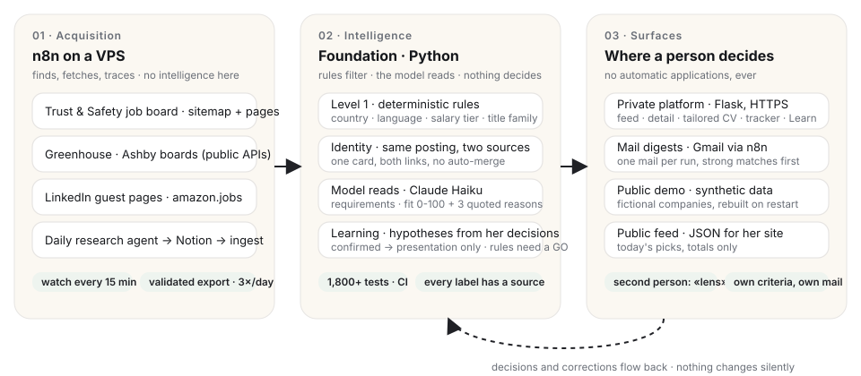
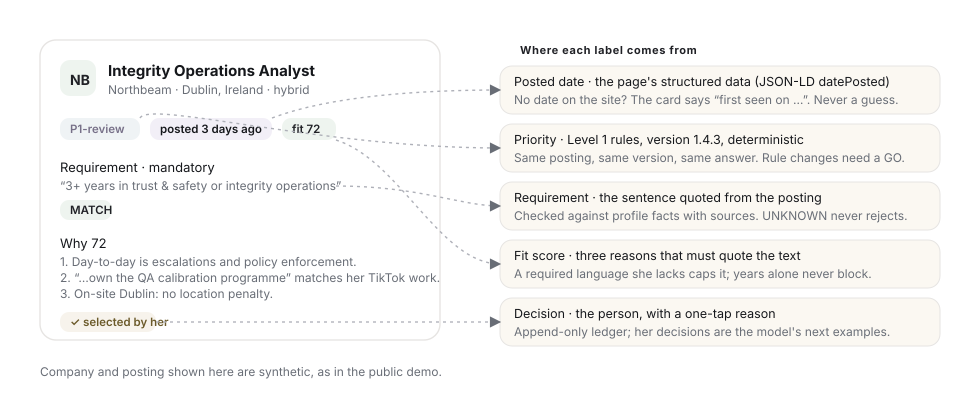

# JIOS — Job Intelligence OS

**An evidence-first decision system I built, run and measure for my own job search.**
Rules filter. A small model reads. I decide. Every label carries its source.

This repository is the public case study. The system itself (code, my profile, my decisions
and the companies I apply to) stays private by design. What is public is the architecture,
the evaluation method and the numbers, plus a [demo on synthetic data](https://demo.188-245-8-49.sslip.io)
with no login and no real company.

Full write-up with the animated walkthrough: [federica-bandiera-portfolio.netlify.app/projects/jios](https://federica-bandiera-portfolio.netlify.app/projects/jios)

---

## Why it exists

A Trust & Safety search in Dublin means watching one specialised board, a dozen company
boards, LinkedIn, Amazon and whatever a research agent finds overnight. Reading all of it by
hand is not a search, it is a second job. The question JIOS answers every morning is simple:
*which of these deserve an hour of my day, and why?*

| | |
|---|---|
| Postings tracked | **2,238** |
| Open today, all with the full description | 581 |
| In Ireland or remote-from-Ireland | 476 |
| Postings I decided on | 155 |
| Pipeline runs | 3 a day, plus a watch every 15 minutes on 25 companies |
| Model cost to date | about $0.48 for 446 requirement readings and 420 fit scores |

(Totals as of 14 November 2026; the live counters are on the portfolio page.)

---

## Architecture

Three layers, each with one job and one owner:

1. **Acquisition** (n8n on a VPS): finds, fetches and traces postings from a Trust & Safety
   job board, Greenhouse and Ashby boards, LinkedIn guest pages, amazon.jobs and a daily
   research agent. It holds no intelligence. A validated export reaches the Foundation three
   times a day.
2. **Intelligence** (the Foundation, Python): a versioned, deterministic rule set applies the
   hard constraints (country, required language, salary tier, title family). Identity groups
   the same posting seen through two sources into one card without auto-merging. Claude Haiku
   reads each surviving description once and returns the requirements, a fit score from 0 to
   100 and three reasons that must quote the text. A learning loop turns my decisions into the
   examples the model sees next time.
3. **Surfaces** (where a person decides): a private Flask platform with feed, detail, tailored
   CV and application tracker; mail digests through n8n; the public demo; a public stats feed
   for my site. Nothing is applied for automatically, ever.

---

## The journey of one posting

A hundred postings are discovered. Deterministic rules keep about twenty. The model reads
each one and scores it. I decide. My decisions feed back into the examples.

| Stage | Owner | What happens |
|---|---|---|
| 01 Discover | n8n | boards, LinkedIn, agents |
| 02 Rules filter | Foundation, rules v1.4.3 | country, language in the title, salary tier, seniority signals. Same posting, same rule version, same answer. |
| 03 Model reads | Claude Haiku | mandatory and preferred requirements, fit 0–100, three quoted reasons. A required language I do not speak caps the score; a years-of-experience line alone never blocks. |
| 04 Person decides | me | select, skip, discard, with a reason |
| 05 It learns | Foundation | decisions become examples; hypotheses about my choices are proposed, and only confirmed ones change what I see, never the rules |

---

## Three design decisions I would defend in an interview

**The interface contains no decision logic.** The platform renders what the Foundation
computes and records what I choose. If the UI disappeared tomorrow, every decision, score and
reason would still be in append-only files with timestamps.

**Every label carries its source.** A posting date comes from the page's structured data or
it is shown as "first seen on". A priority names its rule version. A requirement is the quoted
sentence. A score comes with the reasons that cite the text. Nothing is inferred silently, and
an unknown is never a rejection.

**Rules filter, the model reads, a person decides.** The model is a reader, not a judge: it
never discards, never applies, never changes a rule. That keeps the cost trivial and keeps the
accountability where it belongs.

---

## Measured before it shipped

A score nobody has measured is an opinion. Before the fit score went live I held out 65 of my
own past decisions that the model had never seen and asked how often a posting I selected
scored above one I discarded (AUC).

| What the model reads about me | Agreement with my decisions |
|---|---|
| Hand-written summary (in production) | **92.5%** |
| Generated from all 169 profile facts | 84.8% |
| Generated, summary first, years rule in the prompt | 80.9% |
| Hybrid: summary plus my requirement answers | 85.0% |
| Title rules only (baseline) | about 50% |

Same 65 blind decisions for every row. The generated profiles scored lower because the
profile's CV-integrity cautions ("do not claim…") read as limits. Only the measured best went
to production; the other variants stay selectable for the next round.

### Open questions

- **False negatives.** I only see what the system shows me. A weekly re-read of postings near
  the threshold is the planned check.
- **Time per decision.** The platform records decisions, not how long each took.
- **Real outcomes.** Applications are tracked to their stage, but 18 applications are not yet
  a dataset. The honest statement today: the system is good at agreeing with me, and I do not
  yet know how good I am.

---

## Under the hood

Python 3.11/3.12 · Flask · n8n on a Hetzner VPS · PostgreSQL and n8n Data Tables for
acquisition · Claude Haiku 5.5 for reading · Caddy for HTTPS · systemd timers · Gmail through
n8n for the digests. 1,800+ automated tests, continuous integration on every push. Every
runtime store is append-only: the latest row wins and nothing is rewritten.

Built with Claude Code as a pair programmer, under a written operating protocol: every change
is tested locally, pushes and deployments need my explicit go, and the scoring rules, the
candidate profile and the data contracts are locked components that no automation may change.

---

## About the demo

The public demo runs on synthetic data: fictional companies, generated postings, no login,
rebuilt from scratch on every restart. My real platform, my decisions and the companies I
apply to are never public. The counters here are totals only.

---

**Federica Bandiera** · Dublin, Ireland · Trust & Safety, AI quality and operations
[Portfolio](https://federica-bandiera-portfolio.netlify.app) · [LinkedIn](https://www.linkedin.com/in/federicabandiera)
